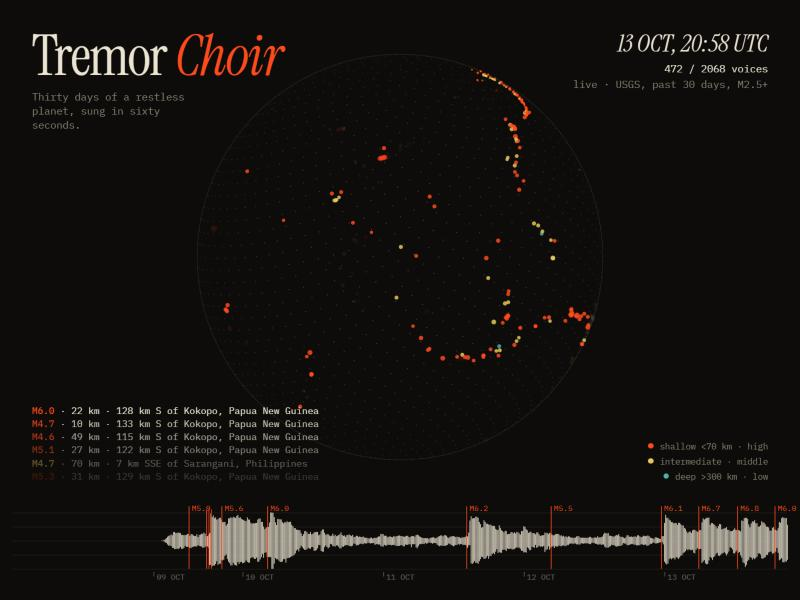

# Tremor Choir

The last 30 days of real earthquakes (about 2,000 of them, from the USGS live feed) replayed in **60 seconds as a choir**, on a slowly turning globe.

No coastlines are drawn. As the voices pile up, the **Pacific Ring of Fire, the Andes and the mid-ocean ridges draw themselves**, so the edges of the tectonic plates appear out of sound.



## Run it

```bash
npm start
```

Open http://localhost:5173 and press **Listen**. Headphones help: every quake is panned to where it happened.

No install step and no dependencies: Node 18+ and a browser are all you need. `npm test` runs the self-checks.

## What you're hearing

| Quake property | Voice |
|---|---|
| depth | pitch: shallow quakes sing high, deep (300–700 km) ones sing low, all in D dorian |
| magnitude | loudness, length and vowel: small ones whisper "ee", big ones open to "ah" and "oo" |
| longitude | stereo position |
| M6+ | the ground answers: a falling sub-bass rumble, a shockwave across the globe and a screen shake |

Colours follow seismology's depth classes: **vermilion** shallow (<70 km), **sulfur** intermediate, **teal** deep (>300 km).

Each voice is a sawtooth "vocal fold" passed through three band-pass filters set to real vowel formant frequencies. That's how speech synthesis worked before samples, and it's why the choir sounds human. A generated reverb tail and a compressor glue the voices together.

The strip at the bottom is a **seismograph drum**: it draws the choir's own audio waveform, with day ticks and red marks for every M5.5+.

## Controls

| | |
|---|---|
| **Space** | pause / resume (the globe freezes so you can tap) |
| **R** | replay |
| **L** or the LIVE chip | live mode: checks USGS every minute and sings each new quake as it happens |
| **drag** | spin the planet |
| **tap / click a dot** | hear that quake again |
| arrows | nudge the globe |

## Data

- Replay: `https://earthquake.usgs.gov/earthquakes/feed/v1.0/summary/2.5_month.geojson` (free, no key)
- Live: `.../summary/all_hour.geojson`
- Offline: if the feed can't be reached, it falls back to `sample.json`, a 2,068-quake snapshot taken on 8 Nov 2026.

## Files

`lib.js` pure mapping and projection (tested) · `app.js` audio, drawing, interaction · `server.js` zero-dependency static server (localhost only, no path traversal, no dotfiles) · `test.js` node:test checks.

---

<details>
<summary>Spoiler: the easter egg</summary>

While it's playing, type **abyss**. The title changes to *Tremor Abyss*, every quake shallower than 300 km goes silent and dark, and only the deep-subduction quakes sing, an octave lower with a long, drowned reverb. These are the slabs of ocean floor sinking hundreds of kilometres into the mantle. Type it again to come back up.

</details>
